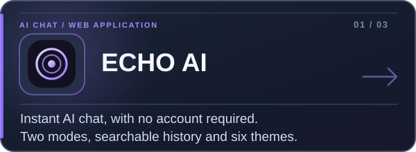
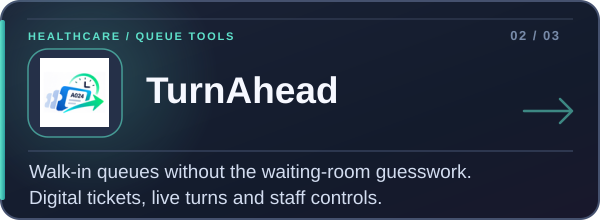
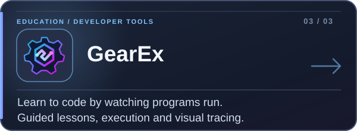

  

### 👋 About Me

I'm a **Computer Science & Engineering student** and **freelance digital creator** who enjoys turning ideas into useful, accessible software. My projects range from AI-powered web tools and interactive programming education to practical systems built around real everyday needs.

I work mainly with **C/C++, Python, and JavaScript**, and care about thoughtful interfaces, dependable functionality, and code that others can learn from. I like building things all the way from the first design to a working, documented release.

---

### 🚀 Featured Projects

  
  

  
  
  &emsp;&emsp;&emsp;&emsp;&emsp;
  
  

  

  
  

  

---

### 📊 GitHub Stats & Languages Used

  

---

### 🤝 Let's Connect

Have a project or an idea worth building? I'm interested in useful collaborations and thoughtful digital work.

  
  &nbsp;&nbsp;
  

---

<strong>Build with purpose. Keep learning. Share what works.</strong>

