 

 

  
  
  

---

### 👨‍💻 About Me

I'm a **Computer Science & Engineering student** and **Freelance Digital Creator** who enjoys turning ideas into useful, accessible software.

I work across programming fundamentals, web interfaces, and practical applications, with an emphasis on clean design and functionality that actually works.

- 🔨 Building open-source websites, developer tools, and real-world utilities.
- 🧠 Exploring **C/C++**, Object-Oriented Programming, Python, and modern web development.
- 💻 Developing practical software with a focus on usability and performance.
- 🎮 Experimenting with game development and interactive experiences.
- 🎯 My goal: **Build it, test it, document it, and make it useful.**

---

### 🚀 Featured Projects

<table>

<tr>
<td width="120" align="center" valign="middle">

</td>

<td valign="middle">
<h3>
<a href="https://github.com/NittinChughani/echoai">
✦ ECHO AI
</a>
</h3>

A free AI chatbot website featuring two response modes,
chat history, customizable themes, and an intuitive interface.
No signup required.

<a href="https://nittinchughani.github.io/echoai/">
<strong>Visit Website</strong>
</a>
&nbsp;·&nbsp;
<a href="https://github.com/NittinChughani/echoai">
Source Code
</a>
</td>
</tr>

<tr>
<td width="120" align="center" valign="middle">

</td>

<td valign="middle">
<h3>
<a href="https://github.com/NittinChughani/TurnAhead">
✦ TurnAhead
</a>
</h3>

A smart walk-in queue management system for clinics and hospitals.
Features QR tickets, live queue tracking, staff dashboards,
and real-time turn notifications.

<a href="https://nittinchughani.github.io/TurnAhead/">
<strong>Visit Website</strong>
</a>
&nbsp;·&nbsp;
<a href="https://github.com/NittinChughani/TurnAhead">
Source Code
</a>
</td>
</tr>

<tr>
<td width="120" align="center" valign="middle">

</td>

<td valign="middle">
<h3>
<a href="https://github.com/NittinChughani/gearex">
✦ GearEx
</a>
</h3>

An interactive programming learning platform featuring
guided lessons, code execution, and step-by-step
code visualization to make programming easier to understand.

<a href="https://nittinchughani.github.io/gearex/">
<strong>Visit Website</strong>
</a>
&nbsp;·&nbsp;
<a href="https://github.com/NittinChughani/gearex">
Source Code
</a>
</td>
</tr>

</table>

**Also Exploring:**

[C Programming — Basic to Advance](https://github.com/NittinChughani/C-CODE-BASIC-TO-ADVANCE)
&nbsp;·&nbsp;
[Explore All Repositories](https://github.com/NittinChughani?tab=repositories)

---

### 🌐 Connect With Me

---

### 📊 GitHub Stats & Most Used Languages

---

**🚀 Always Learning. Always Building. Always Improving.**

