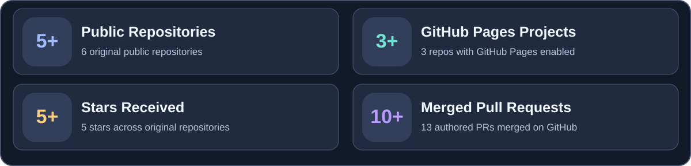

  

---

### 👨‍💻 About Me

I'm a **Computer Science & Engineering student** and **freelance digital creator** based in Pakistan. I build open-source software that makes learning and everyday tasks more accessible.

My work ranges from browser-based AI tools and interactive programming education to practical systems for managing clinic queues. I enjoy taking projects from initial design through implementation, testing, and documentation.

Currently working with **C/C++, Python, and JavaScript**, while exploring software engineering and game development.

---

### 🚀 Featured Projects

<table>
<tr>
<td width="120" align="center" valign="middle">
  
</td>
<td valign="middle">
  <h3><a href="https://github.com/NittinChughani/echoai">ECHO AI</a></h3>
  
A free, no-signup AI chat website with two assistant modes, searchable conversation history, and six themes. Designed for easy access directly from a browser.

  <a href="https://nittinchughani.github.io/echoai/"><strong>Visit website</strong></a> · <a href="https://github.com/NittinChughani/echoai">Source code</a>
</td>
</tr>
<tr>
<td width="120" align="center" valign="middle">
  
</td>
<td valign="middle">
  <h3><a href="https://github.com/NittinChughani/TurnAhead">TurnAhead</a></h3>
  
A walk-in queue platform for clinics, connecting reception and patients through QR tickets, live turn tracking, doctor and room details, and staff dashboards.

  <a href="https://nittinchughani.github.io/TurnAhead/"><strong>Visit website</strong></a> · <a href="https://github.com/NittinChughani/TurnAhead">Source code</a>
</td>
</tr>
<tr>
<td width="120" align="center" valign="middle">
  
</td>
<td valign="middle">
  <h3><a href="https://github.com/NittinChughani/gearex">GearEx</a></h3>
  
An open-source programming workbench with guided lessons across seven languages, code execution, and a step-by-step visualizer for understanding program behavior.

  <a href="https://nittinchughani.github.io/gearex/"><strong>Visit website</strong></a> · <a href="https://github.com/NittinChughani/gearex">Source code</a>
</td>
</tr>
</table>

**More on GitHub:** [C Programming — Basic to Advance](https://github.com/NittinChughani/C-CODE-BASIC-TO-ADVANCE) · [All repositories](https://github.com/NittinChughani?tab=repositories)

---

### 🏆 Achievements & Milestones

<!-- AUTO-ACHIEVEMENTS:START -->

Development milestones and publicly visible GitHub achievement badges refresh daily. Only badges actually detected on GitHub are shown.
<!-- AUTO-ACHIEVEMENTS:END -->

---

### 🌐 Connect With Me

Interested in a collaboration or a freelance project? You can find my work here or get in touch through the links below.

---

### 📊 GitHub Stats & Most Used Languages

  

---

**🚀 Always Learning. Always Building. Always Improving.**

