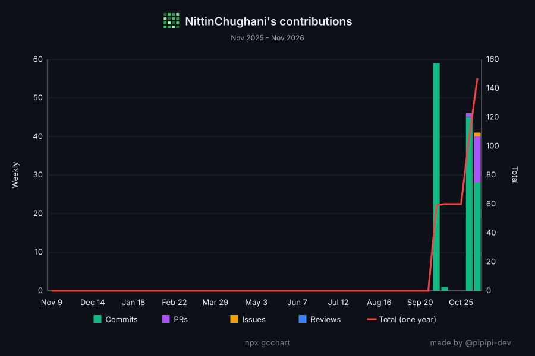

# Hi, I'm Nittin Chughani 👋

### Computer Science & Engineering Student · Software Builder · Digital Creator

  
  
  

---

### 👨‍💻 About me

I'm a **Computer Science & Engineering student** and **freelance digital creator** who enjoys turning ideas into useful, accessible software. I work across programming fundamentals, web interfaces, and practical applications—with an emphasis on clean design and functionality that actually works.

- 🔨 Building open-source websites, developer tools, and real-world utilities.
- 🧠 Exploring **C/C++**, object-oriented design, **Python**, and modern web development.
- 🎮 Experimenting with game development and interactive experiences.
- 🎯 My goal: **build it, test it, document it, and make it useful.**

### 🚀 Featured projects

<table>
<tr>
<td width="120" align="center" valign="middle">

</td>
<td valign="middle">
<h3><a href="https://github.com/NittinChughani/echoai">✦ ECHO AI</a></h3>

A free AI chatbot website with two response modes, chat history and customizable themes—no signup needed.

<a href="https://nittinchughani.github.io/echoai/"><strong>Visit website</strong></a> · <a href="https://github.com/NittinChughani/echoai">Source code</a>
</td>
</tr>
<tr>
<td width="120" align="center" valign="middle">

</td>
<td valign="middle">
<h3><a href="https://github.com/NittinChughani/TurnAhead">✦ TurnAhead</a></h3>

A smarter walk-in queue system for clinics and hospitals, with QR tickets, live tracking and staff dashboards.

<a href="https://nittinchughani.github.io/TurnAhead/"><strong>Visit website</strong></a> · <a href="https://github.com/NittinChughani/TurnAhead">Source code</a>
</td>
</tr>
<tr>
<td width="120" align="center" valign="middle">

</td>
<td valign="middle">
<h3><a href="https://github.com/NittinChughani/gearex">✦ GearEx</a></h3>

An interactive programming learning platform with guided lessons, code execution and step-by-step visualization.

<a href="https://nittinchughani.github.io/gearex/"><strong>Visit website</strong></a> · <a href="https://github.com/NittinChughani/gearex">Source code</a>
</td>
</tr>
</table>

**Also exploring:** [C programming — Basic to Advance](https://github.com/NittinChughani/C-CODE-BASIC-TO-ADVANCE) · [All repositories](https://github.com/NittinChughani?tab=repositories)

### 🛠️ Tech stack

**Languages & web**

**Tools & workflow**

**Areas of interest:** Object-Oriented Programming · Software Engineering · UI/UX · Educational Tools · Open Source · Game Development

### 📊 GitHub at a glance

  
  

#### 📈 Contribution activity

  

Language statistics reflect public repository code, not overall proficiency. Third-party stats and visuals may occasionally be unavailable.

### 🌐 Connect with me

---

**🚀 Always learning. Always building. Always improving.**

