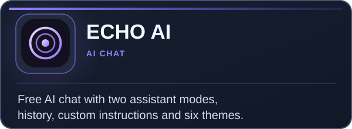
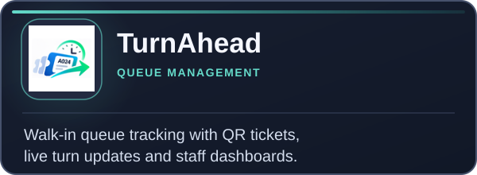
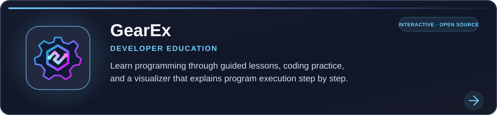
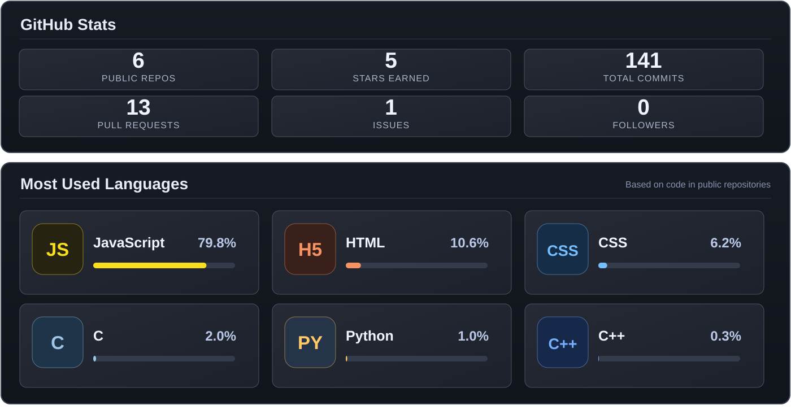

  

---

### 👨‍💻 About Me

I'm a **Computer Science & Engineering student** and **freelance digital creator** based in Pakistan. I build open-source software that makes learning and everyday tasks more accessible.

My work ranges from browser-based AI tools and interactive programming education to practical systems for managing clinic queues. I enjoy taking projects from initial design through implementation, testing, and documentation.

Currently working with **C/C++, Python, and JavaScript**, while exploring software engineering and game development.

---

### 🚀 Featured Projects

  

  
  &nbsp;
  

  

  
  &nbsp;
  

  

  
  &nbsp;
  

  

---

### 🌐 Connect With Me

Interested in a collaboration or a freelance project? You can find my work here or get in touch through the links below.

---

### 📊 GitHub Stats & Languages Used

  

---

**🚀 Always Learning. Always Building. Always Improving.**

